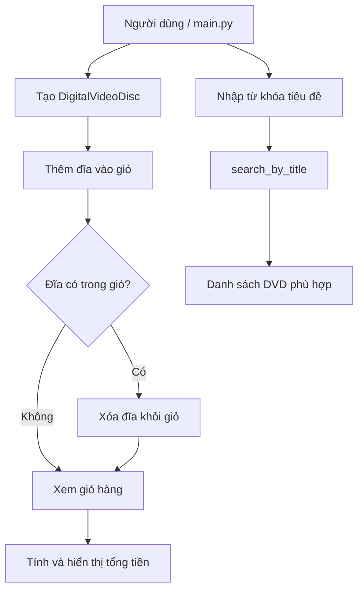

# Các chức năng hiện có của AIMS-mini

AIMS-mini hiện là một ứng dụng dòng lệnh minh họa việc quản lý các đĩa DVD
trong giỏ hàng. Chương trình khởi tạo một số đĩa mẫu trong `main.py`, thêm
chúng vào giỏ và in thông tin tổng tiền.

## Tác nhân

- **Người dùng/chương trình chính (`main.py`)**: thực hiện các thao tác với
  đĩa và giỏ hàng.
- **Giỏ hàng (`Cart`)**: lưu danh sách đĩa, thêm/xóa đĩa và tính tổng tiền.
- **Đĩa DVD (`DigitalVideoDisc`)**: chứa thông tin của một đĩa.

## Danh sách chức năng

| Chức năng | Mô tả | Thành phần |
| --- | --- | --- |
| Tạo đĩa DVD | Tạo một đĩa với tiêu đề, thể loại, đạo diễn, thời lượng và giá. Chỉ tiêu đề là bắt buộc. | `DigitalVideoDisc(...)` |
| Thêm đĩa vào giỏ | Thêm một DVD vào `cart.items`. In thông báo thành công và trả về `True`; nếu số lượng hiện tại vượt ngưỡng kiểm tra thì từ chối và trả về `False`. | `Cart.add_dvd(dvd)` |
| Xóa đĩa khỏi giỏ | Xóa DVD nếu đĩa đang có trong giỏ. In thông báo tương ứng và trả về trạng thái thao tác. | `Cart.remove_dvd(dvd)` |
| Xem giỏ hàng | Kiểm tra giỏ rỗng; nếu có đĩa thì in tổng tiền, nếu không thì in thông báo giỏ rỗng. | `Cart.print_cart()` |
| Tính tổng tiền | Cộng trường `cost` của tất cả DVD trong giỏ. | `Cart.total_cost()` |
| Tìm kiếm theo tiêu đề | Trả về các DVD có `keyword` xuất hiện trong `title`. Việc tìm kiếm hiện phân biệt chữ hoa/chữ thường. | `search_by_title(items, keyword)` |
| Hiển thị thông tin đĩa | Chuyển thông tin DVD thành chuỗi gồm tiêu đề, thể loại, đạo diễn, thời lượng và giá. | `DigitalVideoDisc.__str__()` |

## Sơ đồ chức năng

## Luồng sử dụng mẫu

1. `main.py` tạo một `Cart`.
2. Chương trình tạo các DVD mẫu: *The Lion King*, *Star Wars* và *Aladdin*.
3. Mỗi DVD được thêm bằng `add_dvd`.
4. `print_cart` hiển thị tổng tiền của các DVD hiện có trong giỏ.
5. Khi có danh sách DVD, có thể gọi `search_by_title(items, keyword)` để lọc
   theo tiêu đề; kết quả là một danh sách DVD và không tự động thay đổi giỏ.

## Giới hạn và hành vi hiện tại

- Giỏ hàng được thiết kế với giới hạn `MAX_NUMBERS_ORDERED = 20`.
- Điều kiện hiện tại trong `add_dvd` kiểm tra `len(items) > 20`, nên thực tế vẫn
  có thể thêm đĩa thứ 21; đây là điểm cần chỉnh nếu muốn giới hạn đúng 20 đĩa.
- Chức năng tìm kiếm chỉ tìm trong danh sách được truyền vào và tìm chuỗi con
  trong tiêu đề.
- Chương trình hiện chưa có giao diện nhập liệu tương tác hoặc chức năng thanh
  toán; các thao tác được gọi trực tiếp từ mã Python.